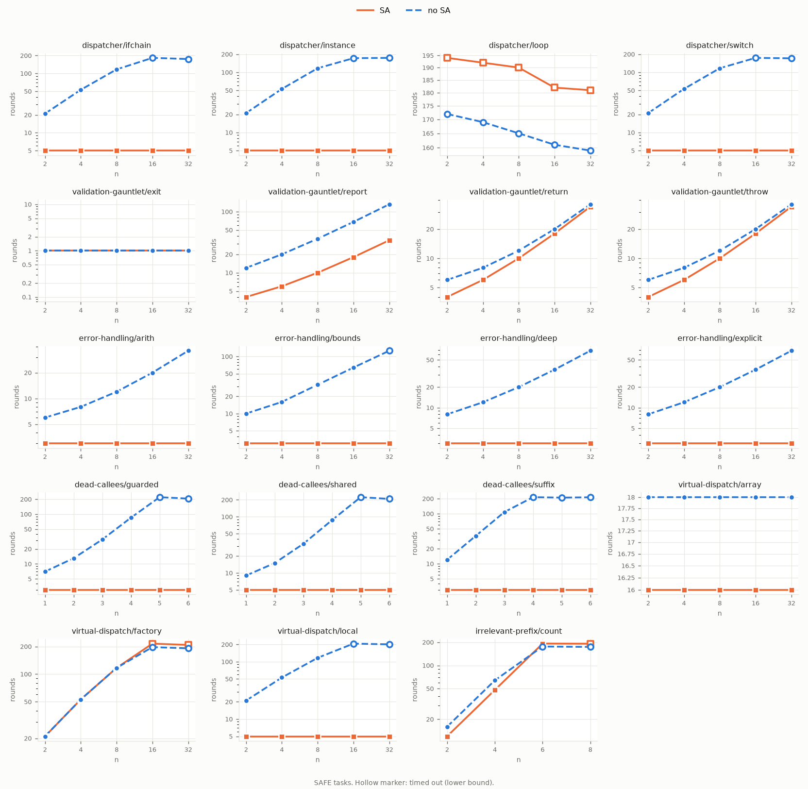
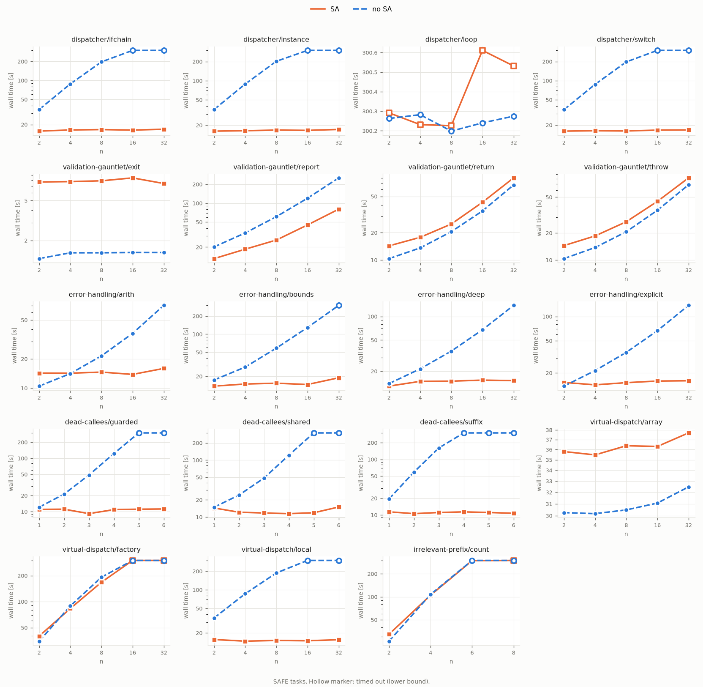

# Where SA pruning helps: results

Runs of 2026-10-14 on `niklas/dev`, cfg-extractor jar of 2026-09-26 (current with
cfg-extraction `cdc73cb`, whose later change was comments only). Tasks and scripts: see
[README.md](README.md).

## Configurations

`svcomp test run --mode parallel --no-witness --categories valid-assert.prp --benchmark-dir
swat-benchmarks --testcase-timeout-s 300`, 48 workers (32 for the soundness reruns) on 128 cores;
one run per configuration, one after the other:

| config | flags | run |
|---|---|---|
| SA | (default: sequential SA, graph used from round 0) | `run_20261014_162721` |
| no SA | `--no-sa` | `run_20261014_163338` |
| SA + rank | `--sa-rank-distance` | `run_20261014_164316` |
| final `sa-soundness` (incl. narrowing tasks) | SA / `--no-sa` | `run_20261014_172545` / `run_20261014_172627` |
| `real-tools` | SA / `--no-sa` | `run_20261014_171457` / `run_20261014_171958` |

The machine was loaded (load ~100), so one round (a fresh JVM) took 1.3-1.9 s instead of ~1.2 s;
both configurations ran under the same load. Rounds and verdicts are deterministic (the soundness
suite gave identical results twice); wall times are not.

## Summary

This summary and the sections up to "Bugs found" describe the runs of 2026-10-14, before the
fixes; for the state after them see "Fixes (2026-10-15/16)".

The two suites answer different questions, so they are counted separately.

Family tasks (194; they measure what pruning gains):

| | correct | timeouts | false SAFE | total wall time |
|---|---:|---:|---:|---:|
| no SA | 147 | 37 | 10 | >= 18571 s |
| SA | 174 | 10 | 10 | 7327 s |
| SA + rank | 175 | 9 | 10 | 6938 s |

The 10 false SAFEs are the same tasks in every configuration, `validation-gauntlet/exit` and
`virtual-dispatch/array`: executor bugs E1 and E2 below. Pruning adds none here.

`sa-soundness` tasks (96; they target the constructs where pruning can go wrong):

| | correct | timeouts | false SAFE |
|---|---:|---:|---:|
| no SA | 71 | 0 | 10 |
| SA | 65 | 0 | 19 |

The 10 false SAFEs without SA are executor bugs (E1-E3) and stay false SAFE with SA. The 9 more
with SA are pruning bugs (S1-S3), listed in the soundness table below. `--sa-rank-distance` was
only run on the first 72 tasks of this suite (before the narrowing tasks were added); there it gave
the same result as SA on every task (11 false SAFE each). It only reorders branches, so it cannot
change which ones are pruned.

- **Pruning helps exactly when the dead side of a branch has a subtree to skip.** Then the pruned
  search is constant in n while the unpruned one grows linearly (dispatcher, error-handling,
  virtual-dispatch/local: 16 paths per handler) or exponentially (dead-callees: 3^n). At n = 8
  the SAFE dispatcher needs 117 rounds / 197 s without SA and 5 rounds / 17 s with it; from
  n = 16 on, no-SA times out.
- **It does not help when the dead side is a leaf** (gauntlet `return`/`throw`: the rejecting side
  is the one the first run takes anyway, so pruning saves 2 rounds of 36), **in event loops**
  (dispatcher/`loop`: a handler in round 0 can still reach the assert in round 1), **at ambiguous
  calls** (virtual-dispatch/`factory`: the graph is incomplete at the call, the walker gives up),
  and **when every path reaches the assert** (irrelevant-prefix control: 2^n in both
  configurations, SA only skips the dead sides of `target`'s own guards).
- **Cost:** extraction takes 4-10 s per task (median 5.5 s under load). With ~1.5 s per round SA
  pays off once it saves about four rounds; for tiny tasks it is a net loss of ~5 s.
- **Soundness: SA turns 9 `sa-soundness` tasks into false SAFE** (10 -> 19) that are correct (or
  UNKNOWN) without it: static initializers on an input-dependent path, exceptions without an edge
  in the graph (ClassCastException, NullPointerException across frames, exceptions thrown inside
  the JDK), and reflection. Separately, the executor gives false SAFE without any pruning for `System.exit`,
  object-array reads at a symbolic index, and lambda bodies. Details and reproducers below.
- **`--sa-rank-distance` never hurt here** and fixed the VIOLATION cases with long paths
  (dispatcher/loop: 5 rounds for every n instead of 8-36 and a timeout at n = 32;
  irrelevant-prefix: 3 instead of 5-11). It changed no SAFE task and no verdict, apart from the
  n = 32 loop task now solved. This differs from SV-COMP (682 -> 635 points), where the shortest
  path to *some* assert point was often the wrong one; here every task has one assert.
- **Real tools (getopt, opencsv) could not show anything:** both are bound by Z3 String solving
  (single queries of 70-264 s) and by a String encoding bug (E4) that makes runs diverge; neither
  configuration got past round 5 in 300 s.

## Per family

SAFE tasks: their search is exhaustive, so they show the whole (pruned) search space. Hollow
markers: timed out, the value is a lower bound. All numbers, also for VIOLATION:
[report/families.md](report/families.md).

| family / variant | rounds no SA -> SA (SAFE) | effect |
|---|---|---|
| dispatcher/switch, ifchain, instance | n=2: 21 -> 5, n=8: 117 -> 5, n>=16: TO -> 5 | all handlers pruned; constant in n |
| dispatcher/loop | TO -> TO | none: event loop |
| validation-gauntlet/report | n=8: 36 -> 10, n=32: 132 -> 34 | the error reports are pruned; the checks still need one round each |
| validation-gauntlet/return, throw | n=32: 36 -> 34 | the dead sides are leaves; ~2 rounds |
| validation-gauntlet/exit | 1 -> 1, false SAFE in both | executor bug E1 |
| error-handling/* (explicit, deep, arith, bounds) | n=32: 36-TO -> 3 | catch paths pruned, also for implicit ArithmeticException/AIOOBE and two frames up |
| dead-callees/suffix, guarded | n=4: 85-TO -> 3; n>=5: TO -> 3 | 3^n dead paths pruned |
| dead-callees/shared | n=4: 87 -> 5; n>=5: TO -> 5 | the context-sensitive walk prunes the dead calls of a helper that is live elsewhere |
| virtual-dispatch/local | n=8: 117 -> 5, n>=16: TO -> 5 | like dispatcher: exact receivers resolve |
| virtual-dispatch/factory | n=8: 117 -> 117 | none: ambiguous call, incomplete graph (correct verdicts) |
| virtual-dispatch/array | 18 -> 16, false SAFE in both | executor bug E2 |
| irrelevant-prefix (control) | n=4: 64 -> 48, n=6: TO -> 192 | exponential in both, as expected |

VIOLATION tasks gain less, and how much depends on where DFS happens to look first: the switch
and instance dispatchers find the target after `n + 4` rounds without SA (the case comparisons
come before the handler bodies in DFS order), the if-chain only after exploring every handler
(same as SAFE). With SA all find it in 3-5 rounds.

## Soundness (`sa-soundness`)

VIOLATION / SAFE result per configuration, with rounds. "unk": UNKNOWN.

| task | VIOLATION no SA | VIOLATION SA | SAFE no SA | SAFE SA |
|---|---|---|---|---|
| anonymous-class | ok/3 | ok/3 | ok/5 | ok/3 |
| anonymous-static-field | ok/3 | ok/3 | ok/5 | ok/4 |
| arith-catch-generic, -local, -up1, -up2 | ok/3 | ok/3 | ok/4-7 | ok/3 |
| bounds-catch-up1, -up2 | ok/3 | ok/3 | unk (E6) | unk (E6) |
| **cce-catch** | ok/3 | **FALSE SAFE/1** | ok/3 | ok/1 |
| **cce-catch-up1** | ok/3 | **FALSE SAFE/1** | ok/3 | ok/1 |
| **clinit-static-call, -new, -field** | ok/3 | **FALSE SAFE/1** | ok/3 | ok/1 |
| **clinit-in-callee** | unk/3 (E7) | **FALSE SAFE/1** | ok/3 | ok/1 |
| clinit-unconditional (control) | ok/2 | ok/2 | ok/4 | ok/2 |
| default-method | ok/3 | ok/3 | ok/5 | ok/3 |
| enum-switch, string-switch | ok/4 | ok/4 | ok/4 | ok/4 |
| explicit-throw-generic-catch (control) | ok/3 | ok/3 | ok/4 | ok/3 |
| finally-assert, finally-exits | ok/3, ok/6 | ok/3, ok/6 | ok/4, ok/7 | ok/4, ok/7 |
| inner-accessor | ok/3 | ok/3 | ok/6 | ok/3 |
| jdk-getmethods, jdk-toarray | ok/3 | ok/3 | ok/3 | ok/3 |
| **library-throw-catch** | ok/3 | **FALSE SAFE/1** | ok/3 | ok/1 |
| **npe-catch-up1** | unk/2 (E5) | **FALSE SAFE/1** | unk/2 | ok/1 |
| npe-catch-local | unk/2 (E5) | unk/2 | unk/2 | unk/2 |
| recursion-depth, recursion-mutual | ok/7, ok/5 | ok/7, ok/5 | ok/11, ok/7 | ok/11, ok/7 |
| ref-eq, ref-ne-chain | ok/3, ok/5 | ok/3, ok/5 | ok/3, ok/5 | ok/3, ok/5 |
| **reflection-noarg** | ok/3 | **FALSE SAFE/1** | ok/5 | ok/1 |
| reflection-invoke, reflection-desync | FALSE SAFE (E3) | FALSE SAFE/1 | ok | ok/1 |
| lambda-predicate, -consumer, -local-noarg | FALSE SAFE (E3) | FALSE SAFE (E3) | ok | ok |
| lambda-static-field, -static-field-noarg | FALSE SAFE (E3) | FALSE SAFE/1 | ok | ok/1 |
| stream-foreach, string-switch-nondet | unk (context loss) | unk | unk | unk |
| synchronized-block, synchronized-throw | ok/4, ok/3 | ok/4, ok/3 | ok/7, ok/5 | ok/5, ok/4 |
| exec-system-exit, -late | FALSE SAFE/1 (E1) | FALSE SAFE/1 | ok/1 | ok/1 |
| exec-object-array-index | FALSE SAFE/3 (E2) | FALSE SAFE/1 | ok/3 | ok/1 |
| exec-int-array-index | unk (E6) | unk | unk | unk |
| exec-string-char | unk (E4) | unk | unk | unk |

Constructs that are handled correctly: implicit ArithmeticException / AIOOBE caught one or two
frames up and as `RuntimeException`, explicit throws caught as a supertype, arrays from JDK calls
(the phantom bounds guard regression), String and enum switches, try/finally duplication,
`refEquals`, recursion at an input-dependent depth, default methods, anonymous and inner classes
(synthetic accessors), `synchronized` (including an exception through the monitor-exit handler),
and `<clinit>` that runs on every path.

## Bugs found

Status as of 2026-10-16: all fixed, see "Fixes (2026-10-15/16)", "S2" and "S2 precision" below.

Each has a minimal reproducing task in `java/sa-soundness/` (VIOLATION variant `_false`). None is
fixed here: the SA ones need extractor changes beyond a local fix, the executor ones an executor
rebuild and SV-COMP re-validation.

### SA (extractor / walk): false SAFE only with pruning

- **S1. Static initializer reached on an input-dependent path.** `<clinit>` is not in the graph,
  so an assert inside it is invisible; the graph has no assertion point at all and DFS prunes the
  branch that leads to the first use of the class (static call, `new`, static field read, or
  inside a branch-free callee). Reproducers: `clinit-static-call`, `clinit-new`, `clinit-field`,
  `clinit-in-callee`; control `clinit-unconditional` (first use on every path) is correct.
  Fix direction: treat the first use of an application class whose `<clinit>` can reach an assert
  (or is not analysed) as an assertion point or an incomplete node, or add implicit call edges.
- **S2. Exceptions the graph has no edge for, caught by the application.** The handler is
  unreachable in the graph, so the branch that makes the exception happen is pruned:
  ClassCastException from a `checkcast` (even in the same method: `cce-catch`; one frame up:
  `cce-catch-up1`), NullPointerException one frame up (`npe-catch-up1`; locally there is an
  EXCEPTION edge), and any exception thrown inside the JDK (`library-throw-catch`:
  `Integer.parseInt` -> NumberFormatException, the usual way CLI tools handle bad arguments).
  This is limitation 2 of `INTER_PROCEDURAL.md`, but its consequence is a false SAFE, not only
  lost precision. Fix direction: for each handler that can catch such types (including
  `RuntimeException`, `Exception`, `Throwable`), mark the statements in its try region that can
  throw them (casts, dereferences, library calls) incomplete, or add EXCEPTION/escape edges.
- **S3. Reflection.** `Method.invoke` is a library call, so it gets no CALL edge and is not marked
  incomplete ("only library targets"); the invoked method's assert is unreachable in the graph
  (`reflection-noarg`). Fix direction: mark `Method.invoke`, `Constructor.newInstance`,
  `Class.newInstance` (and `MethodHandle.invoke*`) incomplete.
- **S4 (latent). Lambdas stored in fields.** An interface call whose receiver comes from a field
  falls back to the application subtypes of the interface; lambda classes do not exist statically,
  so a `Runnable`/`IntConsumer` field holding a lambda resolves to "only library targets": no
  edge, not incomplete, no assertion point (`lambda-static-field`, `lambda-static-field-noarg`).
  Currently hidden because the executor misses these violations anyway (E3); it becomes a false
  SAFE once E3 is fixed. Fix direction: treat interface calls on functional interfaces as
  incomplete when the program has lambda bodies.

(Superseded: S1, S3 and S4 are now fixed in the extractor.) A cheap stop-gap in SWAT for S1, S3
and S4: do not use a graph that has no assertion point
(`metadata.assertionPointIds` empty) while the program has an assert; all of those reproducers
have such a graph. It does not cover S2.

### Executor: false SAFE or lost results, also without pruning

- **E1. `System.exit` loses the trace.** A run that ends in `System.exit` reports no branches, so
  exploration stops with SAFE after the first round (`exec-system-exit`, also when branches were
  recorded before the exit: `exec-system-exit-late`; `validation-gauntlet/exit`).
- **E2. Object array read at a symbolic index** is not a choice point and is not flagged as
  precision loss, so other elements are never tried: false SAFE (`exec-object-array-index`,
  `virtual-dispatch/array`).
- **E3. Lambda bodies record no symbolic branches,** neither for arguments passed through the
  JDK's lambda forms nor for static fields read inside a no-argument lambda, and this is not
  flagged as context loss: false SAFE (`lambda-*`). The same for arguments passed through
  `Method.invoke` (`reflection-invoke`, `reflection-desync`; `reflection-noarg`, which reads a
  static field instead, works).
- **E4. String inputs have no character range bound.** `StringValue.getBounds` returns `true`,
  and `charAt` is the code point truncated to 16 bits, so Z3 may answer `charAt(0) == '-'` with
  U+1002D; Java then sees a different string and the run diverges ("Target did not explore branch
  ... as expected"); the result is lost (`exec-string-char` gives UNKNOWN for VIOLATION). This
  blocked both real tools. Fix direction: bound input strings to `\u0000-￿` (e.g.
  `str.in_re` with a range) or encode `charAt` without truncation.
- **E5. NullPointerException on `getfield`** halts the executor ("Trying to get a field of NULL"):
  UNKNOWN (`npe-catch-local`). With SA, `npe-catch-up1` turns this UNKNOWN into a false SAFE (S2).
- **E6. "Error retrieving value for SV-Comp (at instruction 4)"** after solving for an int that is
  used as an array index: UNKNOWN (`exec-int-array-index`, `bounds-catch-*_true`).
- **E7. "Invocation stack is broken"** when a `<clinit>` runs inside a callee: UNKNOWN
  (`clinit-in-callee_false` without SA).

### Harness (fixed)

- `svcomp test run --benchmark-dir` crashed for folder names other than `sv-benchmarks`
  (`939933e`).

## Fixes (2026-10-15/16)

The sections above describe the state of 2026-10-14. All bugs found then are fixed except S2,
which is deferred to the planned trace-event redesign (see "Planned redesign" in the workspace
`CLAUDE.md`). Fixing them turned up more bugs, which are fixed too. SWAT commits are on
`niklas/dev`, extractor commits on cfg-extraction's `find-assertions`.

| bug | cause | fix | commit |
|---|---|---|---|
| S1 static initializers | `<clinit>` is not in the graph, so the path to a class's first use was pruned | statements that may initialize a class whose initializer can reach an assert (`new`, static calls and fields, via superclasses, transitively, also through application overrides of library methods) are assertion points (`ClinitTargets`) | cfg `8facdc9`, `8e2d20f` |
| S3 reflection | `Method.invoke` counted as a library call with nothing behind it | reflective calls (`Method.invoke`, `newInstance`, `Class.forName`, `MethodHandle.invoke*`) are incomplete | cfg `39a20fc`, `8e2d20f` |
| S4 lambdas in fields | lambda classes are not in the view, so an untraceable receiver had "only library targets" | untraceable receivers of an interface a lambda implements are unresolved, so incomplete | cfg `5ae7bf6` |
| S2 unguarded exceptions | see above | fixed on 2026-10-16, see "S2" below | |
| E1 `System.exit` | the trace was never sent | `System.exit`, `Runtime.exit`/`halt` send the trace first | `90fd881` |
| E2 symbolic object-array index | only the concrete element is tracked | sound only: records precision loss (UNKNOWN instead of false SAFE) | `d612f78` |
| E3 lambdas | the body ran in "unknown space", skipped silently | non-capturing lambda bodies run as the interface method; untracked instrumented code records context loss | `b67695d` |
| E3 reflection | `Method.invoke` arguments arrived boxed, and static targets got a receiver | arguments are unboxed, static targets get no receiver, `Object[]` arguments are checked for symbolic content | `45c2cd6` |
| E4 String chars | String inputs had no 16-bit bound | inputs are bounded to `\u0000-￿` | `16303f1` |
| E5 NPE on `GETFIELD` | the executor halted | the exception is followed like any other | `3b2b979` |
| E6 input name collision | solutions were matched to inputs by index (`[I_0` overwrote `I_0`) | matched by name; non-inputs ignored | `b6573fb` |
| E7 initializer left by an exception | its invoke stayed open | closed when the invoke below it ends | `f1ee845` |
| new: solved Strings | Z3's `as_string()` output is escaped (and ambiguous), and was passed on verbatim | read by code point, escaped for the command line, unescaped by `Verifier` | `16303f1` |
| new: String precision check | constraints on `java/lang/String_N` counted as precision loss (name pattern), so no task constraining a String symbolically could be SAFE | trace inputs are accepted by name | `afbd1db` |
| new: equal String inputs | `unescape("")` returned the interned `""`, so two empty inputs were one object and shared one variable (two false SAFEs on SV-COMP before this fix) | every String input is a fresh object | `5c0fdec` |
| new: `String.indexOf(String, int)` | modelled without Java's clamping of `fromIndex` | clamped into `[0, length]` | `34cd826` |
| new: `StringBuilder.setLength` | not modelled: any reused builder halted the executor | modelled for concrete lengths | `1a05ac4` |
| new: divergence ended in SAFE | a solution that did not reach its branch still marked the branch solved; nothing was left to try | an unexpected divergence makes a SAFE verdict UNKNOWN | `18b0af7` |
| new: divergence check by id | the check took the first trace element with the target's id, but ids repeat (all keys of a `LOOKUPSWITCH` share one, `TABLESWITCH` case numbers wrap at 16), so it reported divergences that did not happen | the target is found at its depth in the tree | `fc8e88e` |

Reproducers are in `sa-soundness` (`exec-*` and the pairs named in the bug lists above), except
for the two divergence fixes, which are covered by `symbolic-explorer/tests/test_divergence.py`
and by `dispatcher/switch_n32` and `instance_n32` and `virtual-dispatch/local_n32` (32-case
switches). The two reproducers added last (`exec-equal-string-inputs`,
`exec-indexof-negative-from`) were not checked against the code before their fixes.

### Results after the fixes

swat-benchmarks (300 tasks; the 2026-10-14 runs had 266, without the narrowing tasks and real
tools). Final runs `run_20261016_094623` (SA), `_095359` (no SA), `_100453` (rank), with the
three n = 32 SAFE tasks that the id-based divergence check had turned UNKNOWN rerun after
`fc8e88e` (all SAFE again, in both SA configurations):

| | 2026-10-14: correct / false SAFE | 2026-10-16: correct / false SAFE |
|---|---|---|
| no SA | 203 / 15 (of 266) | 238 / 0 (of 300) |
| SA | 227 / 21 | 259 / 5 |
| SA + rank | 228 / 21 | 262 / 5 |

- Without SA there is no false SAFE left. The five with SA are all S2: `cce-catch`,
  `cce-catch-up1`, `library-throw-catch`, `npe-catch-local`, `npe-catch-up1`.
- The families behave as on 2026-10-14 (constant rounds with SA for dispatcher, error-handling,
  dead-callees, virtual-dispatch/local), except: `validation-gauntlet/exit` is now correct (E1;
  no gain from SA, as the graph treats `exit` as a call that returns), and
  `virtual-dispatch/array` is UNKNOWN instead of a false SAFE (E2). A few tasks that took
  250-300 s on 2026-10-14 now time out at 300 s; the machine was busier (see below).

SV-COMP (current suite, valid-assert, SA, 300 s, 50 workers): baseline = the code from before
these fixes (`939933e` with the jars of 2026-09-26/29), in a separate worktree.

| | points | correct | false SAFE | false VIOLATION |
|---|---:|---:|---:|---:|
| baseline (`run_20261016_083422`) | 879 | 710 | 0 | 0 |
| fixed (`run_20261016_092145`) | 889 | 718 | 0 | 0 |

- 13 tasks now correct that were not: `NullPointerException2-4`, `StaticCharMethods02/06`,
  `char1`, `StringBuilderConstructors01`, `startswith` (jbmc/jdart), `Pred9`, `Refl4` (S1 via
  `Class.forName`), String `compareTo`, `BinaryTreeSearch-MemUnsat02`, `Trie-MemUnsat01`.
- 5 correct before, not now; none is a false SAFE:
  - `Trie-FunSat01`, `Trie-MemSat01`: SAFE -> UNKNOWN. They index an object array with a symbolic
    char (`x.next[c]`); the baseline's SAFE was right by luck (E2).
  - `Piecewise_true`: SAFE -> UNKNOWN: a solution did not reach its branch, so the search was not
    exhaustive; the baseline reported SAFE regardless.
  - `Long_shortValue`, `TCAS_prop1`: timeouts. They took 282 s and 264 s in the baseline already;
    the final run was on a busier machine (load ~150; executor rounds 1.5x slower, and the barely
    changed extractor equally). Run one at a time, the old and the new executor take the same time
    on these tasks.
- `Optimization4` and `UnsatAckermann01` are wrong in both (UNKNOWN before, timeout now);
  `UnsatAckermann01` ended early in the baseline only because of an executor error.
- One more false SAFE pair appeared on the way (`autostub` String `length` and
  `indexOf(String, int)`), caused by the String fixes themselves; both are fixed
  (`5c0fdec`, `34cd826`) and covered by reproducers.

### S2 (2026-10-16)

Design "B" of the planned redesign (see the workspace `CLAUDE.md`):

- **Marking** (extractor, `PseudoExceptions`): statements that may throw an exception SWAT has no
  guard for (calls, instance field and array accesses, casts, array lengths, monitors, throws)
  get EXCEPTION edges to every local handler that might catch it and to an
  `uncaught[?Exception]` node; with Error handlers in the program, every statement does the same
  for `?Error` (only handlers for `Throwable`, `Error` or its subclasses). CALL edges list their
  candidate handlers (`unknownHandlers`). SAGraph treats a pseudo escape as caught by any listed
  handler, or by none. Commits: cfg `3b1fdf2`, SWAT `9ce3d15`.
- **Walk** (executor + `dfs`): when an exception happens that the graph does not model precisely
  (anything but a guard failure or an explicit `throw`), the executor records an
  `UNMODELLED_EXCEPTION` special event, and `dfs` stops trusting the graph for the rest of that
  path (`552bcc0`). Guarded and explicit exceptions keep their precise walk, so the
  error-handling family keeps its pruning.
- Found on the way: a static initializer left by an exception that was triggered by a field
  access stayed open, so the handler below ran as untracked code (`86c0da2`).

Results: the five S2 pairs and three new reproducers (`npe-in-callee-branch`,
`error-in-initializer-catch`, `finally-npe`) are correct with and without SA. swat-benchmarks
(306 tasks): SA 270 correct / 0 false SAFE (before: 256 / 5), SA + rank 271 / 0, no SA 241 / 0.
SV-COMP: unchanged at 889 points, 718 correct, 0 false SAFE (`run_20261016_143432`). The marking
oracle (`check_marking_on_graphs.py`) finds no unsound marking on all 636 SV-COMP graphs; the share
of pruned branch sides drops from 8.6% to 8.3%, all of it in `algorithms` (16.1% -> 11.5%), whose
handlers lead to asserts. Graphs grew by 11% in nodes and 63% in edges.

### S2 precision: resuming at the handler (design C, 2026-10-16; removed 2026-10-17)

Superseded by resync (next section), which recovered the same in every measurement; the code was
removed. Kept here for the measurements.

With B, every unmodelled exception ends pruning for the rest of the path. Measured on the
`exception-dispatch` family (input-dependent dispatch after the handler), the `npe` variant needed
26, 58, 122 rounds for n = 2, 4, 8 and timed out above that, while `explicit` (same program, an
explicit throw) stays at 10 rounds for every n.

- **Executor:** at the start of every catch handler the instrumentation records a
  `HANDLER_ENTRY d key` special event: `d` is the frame depth relative to the last branch, `key` is
  `owner.name(desc)|caught types|protected lines` (`HandlerKeys`), built from content because
  SootUp keeps neither bytecode offsets nor the exception table's order.
- **Extractor:** handler entry nodes carry the same key (`handlerKey`); keys that are not unique in
  their method (javac's copies of a `finally` handler) are left out.
- **Walk:** after `UNMODELLED_EXCEPTION`, `dfs` remembers where it was; at the next
  `HANDLER_ENTRY` it pops `-d` frames off its own call stack and resumes at the handler node, if
  the key is known and the handler is in the method of that frame. Anything else (unknown or
  ambiguous key, a handler in a callee entered after the last branch, `d > 0`) keeps giving up,
  which is always safe.

Results: `npe` now matches `explicit` exactly (6 rounds VIOLATION, 10 SAFE, for every n).
New reproducers `npe-recursive-catch` (the handler is in one activation of a recursive method) and
`npe-handler-in-callee` (must give up) are correct in all configurations. swat-benchmarks
(330 tasks): SA 296 correct / 0 false SAFE, SA + rank 297 / 0, no SA 258 / 0; apart from the new
tasks only `validation-gauntlet/exit_n32` changed (it sits at the 300 s limit). SV-COMP: 890
points, 719 correct, 0 false SAFE (`run_20261016_205345`; the two changed tasks are solver-time
noise at the timeout). Graph structure is unchanged on all 636 SV-COMP graphs; 190 of them carry
handler keys. Commits: cfg `726a144`, SWAT `6fb7464`, `50ce3ff`, `7f6aa4c`.

### Branch keys, desync detection and resync (2026-10-17)

The rest of the planned redesign: the walk is still positional, but every branch is now checked
against the trace, and the walk finds the graph again after losing it.

- **Keys.** Every branch and call site is named `owner.name(desc)|line|kind|ordinal` (kind: `if`,
  `switch`, `arr`, `newarr`, `div`, `call:name(desc)`; ordinal: position among that kind on the
  line, in bytecode order; `#value` / `#n` for a switch case / an array dimension). The executor
  names instructions while instrumenting (`instrument/BranchKeys`), the extractor names graph nodes
  (`BranchKeys`). SootUp keeps no bytecode offsets, so the extractor reads the class file with ASM
  and keeps an exact ordinal only where it can prove it: SootUp's `getStmts()` order is wrong for a
  switch on a String, `getBlocksSorted()` order is wrong for javac's `finally` copies. Same-kind
  instructions on a line whose signatures (an `if`'s operator and constant, a call's constant
  argument, load/store) do not tell them apart get an open ordinal (`|*`, matching any); lines
  whose kinds differ from the bytecode get no key. On the 636 SV-COMP graphs 93% of branch nodes
  have a key, 22% of those with an open ordinal.
- **Stack deltas.** Each trace branch also carries the frames popped and the call sites (keys)
  pushed since the previous branch. Frames of SWAT's own helpers (`UtilInstrumented.refEquals`)
  are left out, since the graph has their branches inline.
- **Desync detection.** At every branch `dfs` checks the graph node's key and its call stack
  against the trace (`check_branch`). A mismatch stops the walk on that path and records
  `sa_desync`, which turns SAFE into UNKNOWN: an unkeyed branch before it may already have been
  mispaired.
- **Resync.** Whenever the walk has no graph node (after an unmodelled exception, a desync, an
  incomplete node), `dfs` looks up the next branch by key and rebuilds the call stack from the
  trace's call sites (`resync`), provided every frame maps to a call site whose callee is the next
  frame's method.

Results: swat-benchmarks unchanged in verdicts (SA 296, SA + rank 297, no SA 262 of 330 correct,
0 false SAFE, no desync); resync removes most unpaired visits in `lambda-*`, `reflection-*`,
`finally-*`, `npe-handler-in-callee`, `anonymous-static-field`, and several SAFE tasks need fewer
rounds (`lambda-consumer_true` 5 -> 3). SV-COMP: 891 points, 720 correct, 0 false SAFE
(`run_20261017_102120`). Detection found one real desync class: in `nanoxml` and `printtokens`
(java-ranger-regression) a JDK `PushbackReader` calls back into the application's `IntReader.read()`;
the graph walks over the library call, so the old walk silently paired the callback's branches with
`StdXMLReader.atEOF()`. The verdicts were already UNKNOWN (context loss). Key mismatches found on
the way (string switches, `finally` copies, the `refEquals` helper frame) are fixed.

Design C compared with resync alone (handler resumption switched off): no difference in verdicts,
rounds or unpaired visits on `exception-dispatch` and `sa-soundness`, and on SV-COMP (891 points
both, `run_20261017_100011`); the two tasks that differ are solver-time noise at the timeout.
Commits: cfg `6b5ee5a`, SWAT `1568fec`, `fc817ee`. Design C was removed afterwards.

### Still open

- Library code calling back into application code (e.g. `PushbackReader` around an application
  `Reader`): the graph does not model it; the walk now detects the desync, but the extractor could
  mark such library calls incomplete.
- Calls the extractor cannot resolve (ambiguous receivers) have no CALL edge, so a frame entered
  through one cannot be rebuilt and resync stays off inside it (`virtual-dispatch/factory`).
- Fresh arrays have a free base variable (`[I_0`), which counts as precision loss: SAFE tasks that
  read an array at a symbolic index stay UNKNOWN (`bounds-catch-*_true`, `exec-int-array-index_true`).
  A constant-array base for `newarray` would fix it, but changes array modelling everywhere.
- Real tools still time out: getopt and opencsv get through ~13 instead of ~5 rounds; opencsv
  loses context in `ArrayList.add` of the parsed fields.

## Real tools (step 4)

| task | no SA | SA |
|---|---|---|
| `getopt-minitar` (GNU java-getopt 1.0.13, 3 nondet argv strings) | timeout after 4 rounds | timeout after 5 rounds |
| `opencsv-import` (opencsv 2.3 `CSVParser`, 1 nondet line) | timeout after 4 rounds | timeout after 4 rounds |

Both are plain Java and fully analysable (no incomplete nodes, the walk never gave up), and SA
did prune (81 of 324 and 26 of 290 DFS visits had a dead side). But exploration is not the
bottleneck: single Z3 String queries took 264 s (getopt) and 70 s (opencsv), and both runs then
diverged on supplementary code points (E4). Two structural notes for later attempts:

- getopt is driven by a loop in the caller, and the opencsv parser loops over the characters, so
  most branches can reach a post-parse assert in a later iteration: the event-loop shape, with
  pruning limited to the early exits (help, version, usage errors, rejected records).
- Picking argv tokens from a fixed list with `nondetInt` instead avoids String solving, but then
  the tool's own branches are concrete and the only symbolic branches are the token choices,
  which all come before parsing and can all reach the assert: nothing to prune.

Tools in `org/apache`, `com/google` or `com/fasterxml` (commons-cli, commons-csv, Gson, Jackson)
are excluded from instrumentation by `sv-comp.cfg`, and JSON parsers mostly read through a
`java.io.Reader`, which loses the symbolic chars; so they were not tried.

## Recommendations

1. S1, S3 and S4 are fixed in the extractor (2026-10-15/16), so the zero-assertion-point stop-gap
   is no longer needed. SA SAFE verdicts are still not trustworthy for programs that catch
   unguarded or JDK exceptions (S2, fixed by designs B and C). Add the `sa-soundness`
   suite to the regression runs: it takes about a minute per configuration.
2. Pruning pays off for programs whose dead branches lead into substantial code: dispatchers and
   command handlers, error handling and reporting, helpers called only on rejected paths. That is
   the shape of security-sink reachability or crash reproduction at a single site in a
   command-style program. Expect nothing for event loops, all-paths-reach-the-assert programs and
   ambiguous dispatch.
3. Keep `--sa-rank-distance` in mind for single-target tasks: here it was never worse and it found
   deep violations in constant rounds. It is still a poor default for programs with many asserts
   (SV-COMP).
4. Before trying real parsers again, fix E4, and consider `--solver-rlimit` so that slow String
   queries do not stall the whole search.
